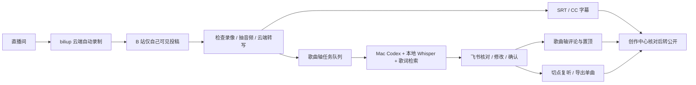

# bilibili-live-replay

把一场直播整理成可以审核、发布和切片的录播：**云端录制与私密投稿 → 飞书通知 → 字幕 → 歌曲识别 → 人工修订 → 发布**。

面向录播维护者、切片爱好者和希望二次开发的小型工具。来自一套实际使用过的端云流程，现拆成配置、脚本和可复用的 Agent 技能。它是工作流工具包，还不是带安装向导的 App。

## 工作方式



云端不需要 Codex 登录；Mac 不需要 B 站 Cookie。Mac 离线时歌曲轴排队，云端录制和字幕继续。飞书自定义机器人负责通知，Mac 上的 `lark-cli` 用户登录负责读取指定审核人的回复。

## 包含什么，哪些还需人工

| 环节 | 实现与边界 |
|---|---|
| 自动候播、录制、私密投稿、分 P | 外部依赖 [biliup](https://github.com/biliup/biliup)，在其管理页配置 |
| 云端处理 | `replay.py`：FFprobe、完整解码、抽音频、Paraformer、SRT、队列和 CC 字幕 |
| 飞书协作 | 阶段通知、审核人白名单、版本确认码、修改后重新确认 |
| 歌曲识别 | `mac/worker.py` + 任务模板：双 ASR、短窗重转、歌词检索、历史曲库线索 |
| 单曲切片 | `mac/CLIP.md` 找候选切点，人工听审后用 `tools/clip.py` 导出 |
| 最终转公开 | 创作中心人工核对后提交，见 [发布流程](docs/publishing.md) |
| 弹幕 | 可使用 biliup 的弹幕录制/录后合成功能；本仓库不含独立弹幕补录器 |
| 其他直播平台 | 录制端可由 biliup 支持；本仓库字幕/稿件/评论适配目前仅针对 B 站 |

**开源版增加了显式 BVID 绑定。** 上传后需要给处理会话绑定一次正确稿件，再自动上传字幕和处理已确认的歌曲轴。旧版仅凭标题和时间找稿，可能改到另一场，因此没有保留这个默认行为。

## 从这里开始

- [云端和 Mac 部署](docs/deployment.md)：依赖、配置、biliup 钩子、后台运行、恢复。
- [歌曲识别方法](docs/song-recognition.md)：技巧、时间映射、多语言、证据和误判处理。
- [历史实验与局限](docs/evaluation.md)：保留方法与汇总，不携带真实直播或私人运行记录。
- [发布、分 P、切片和弹幕](docs/publishing.md)。
- [架构与二次开发](docs/architecture.md)：把文件协议接入自己的 App/Agent。
- [隐私与凭据](SECURITY.md)、[依赖与来源](THIRD_PARTY.md)。

先做完全离线的演示：需要 Python 3.9+、FFmpeg/FFprobe；不需要任何账号或模型。

```sh
git clone https://github.com/zhangdongming0607/bilibili-live-replay.git
cd bilibili-live-replay
python3 tools/demo.py --out work/demo
python3 -m unittest discover -s tests -v
```

演示使用生成的测试视频和虚构转写，验证检查、抽音频、字幕、歌曲轴和切片文件链路，**不证明云端接口、模型识别或真实投稿成功**。

如果只需要手动录一场、媒体检查或歌曲轴，可单独使用 `skills/bilibili-live-replay/`。技能自带录制脚本只在手动启动后录当前一场；云端自动候播由 biliup 负责，两者不要同时录同一个房间。

许可证：[MIT](LICENSE)。仓库不包含用户账号、真实房间、服务器地址、音视频、Cookie、密钥、私人曲库或历史提交。转载来源与授权按实际素材填写。
